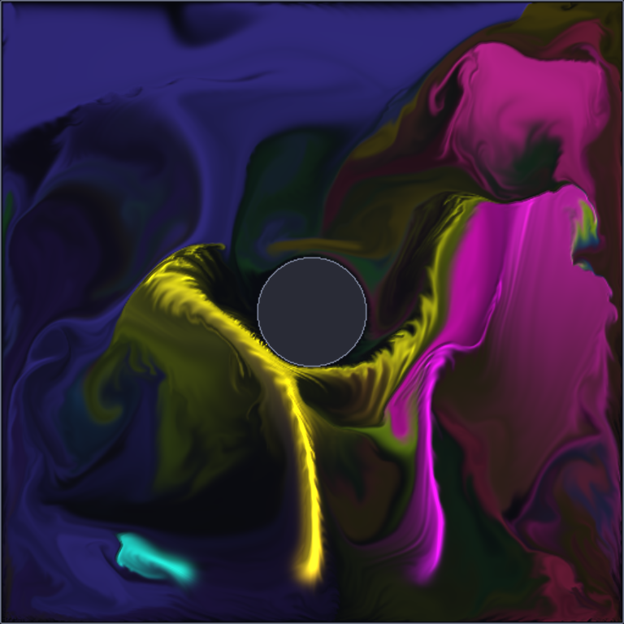
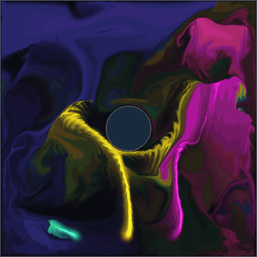
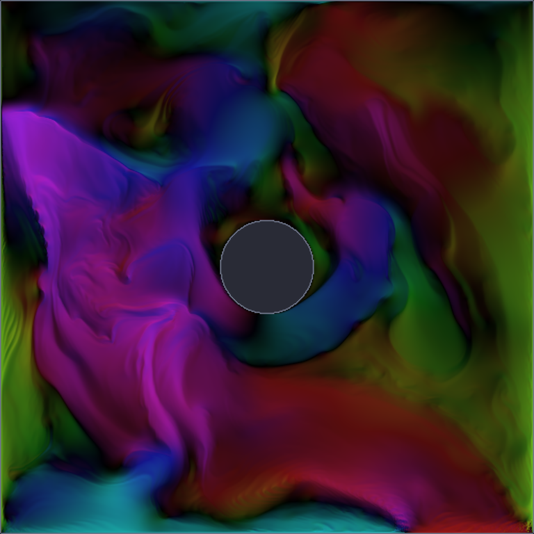
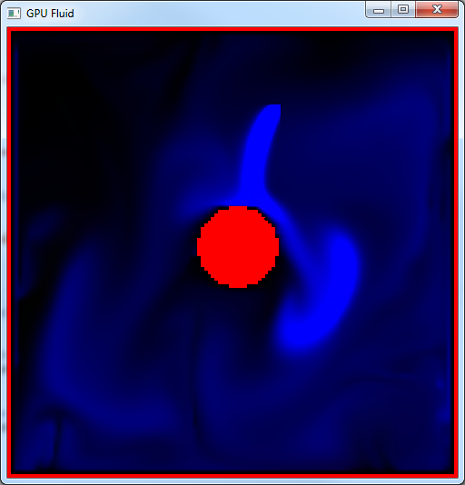

# GpuFluid

GPU based 2D fluid simulator in C++ and OpenGL. Every step of the solver runs as a
fragment shader pass over floating-point textures: advection, buoyancy, vorticity
confinement, divergence, a Jacobi pressure solve and the pressure projection.
Drag the mouse to stir the fluid and pour coloured smoke into it.



<p>
  
  
</p>

## Features

- Stable-fluids style solver on the GPU (Stam 1999, GPU Gems ch. 38): semi-Lagrangian advection,
  Jacobi pressure iterations, free-slip obstacles
- Hot smoke rises and dense smoke sinks (buoyancy), with an obstacle in the middle of the box
- Vorticity confinement brings back the small swirls that advection smooths out
- Coloured dye with a cosine palette, soft exposure and fake lighting from the smoke thickness
- Views for dye, velocity (hue = direction), pressure (with isolines) and the classic 2014 look
- Configurable grid size, Jacobi iterations and vorticity strength from the command line
- `--demo` mode with scripted emitters, plus frame dumps to PNG, so it can run without a mouse

## Controls

| Input | Action |
|---|---|
| Left mouse drag | Push the fluid along the drag and warm it up |
| Right mouse drag (or Shift + left) | Pour coloured smoke |
| `1` `2` `3` `4` / `Tab` | Dye / velocity / pressure / classic 2014 view |
| `Space` | Pause |
| `R` | Reset |
| `O` | Toggle the obstacle |
| `V` | Toggle vorticity confinement |
| `D` | Toggle the demo emitters |
| `+` / `-` | Exposure |
| `S` | Save a screenshot (`gpufluid-000.png`, ...) |
| `Esc` | Quit |

## Building

Requires CMake 3.16+, a C++17 compiler and an OpenGL 3.3 capable GPU. GLFW is downloaded
automatically by CMake; the glad loader and stb_image_write are included in `external/`.

**Linux** (Debian/Ubuntu packages, others are similar):

```sh
sudo apt install build-essential cmake git pkg-config xorg-dev libwayland-dev libxkbcommon-dev
cmake -S . -B build
cmake --build build -j
./build/GpuFluid
```

**Windows** (Visual Studio 2019+ with the "Desktop development with C++" workload):

```bat
cmake -S . -B build
cmake --build build --config Release
build\Release\GpuFluid.exe
```

**macOS** (Xcode command line tools, `brew install cmake`):

```sh
cmake -S . -B build
cmake --build build -j
./build/GpuFluid
```

To use a GLFW that is already installed instead of downloading it, configure with
`-DGPUFLUID_SYSTEM_GLFW=ON`. Shaders are loaded from `Shaders/` and copied next to the binary at build time.

## Command line

```
--grid N            simulation grid N x N (default 512, try 256 on older GPUs)
--size WxH          window size (default 768x768)
--iterations N      Jacobi pressure iterations (default 40)
--vorticity F       vorticity confinement, 0 = off (default 0.5)
--no-obstacle       start without the circle in the middle
--view NAME         dye | velocity | pressure | classic
--demo              scripted smoke emitters, no mouse needed
--frames N          quit after N simulation steps
--dump DIR          save frames as DIR/frame-XXXXX.png
--dump-every K      save every K-th frame (default 1)
--screenshot FILE   save the last frame to FILE on exit
```

For example, `./build/GpuFluid --demo --frames 600 --screenshot smoke.png` renders 600 steps and saves the
last one. The screenshots above were made this way under Xvfb with Mesa's software renderer.

## How it works

Each frame `FluidSimulator::Step()` runs these passes, ping-ponging between textures:

1. `advect.frag`: move velocity, density, dye and temperature along the velocity field
2. `buoyancy.frag`: temperature pushes the smoke up, density pulls it down
3. `curl.frag` + `vorticity.frag`: vorticity confinement
4. `divergence.frag`, then 40 x `jacobi.frag`: solve for pressure
5. `pressure.frag`: subtract the pressure gradient so the velocity is divergence free
6. `view.frag`: draw the selected field

Mouse input and demo emitters add gaussian splats with `splat.frag`.

## History

- **2014**: original version for Windows: Visual Studio project, freeglut, the Unofficial OpenGL SDK
  (glload, glm), GLSL 1.30. Blue smoke, red walls:

  

- **2026 refresh**: same solver and shaders, ported to CMake + GLFW + glad and OpenGL 3.3 core so it builds on
  Linux, Windows and macOS. Added coloured dye, vorticity confinement, higher and configurable resolution,
  view modes, pause/reset, a demo mode with PNG output, and fixed a few old bugs (texture sampler setup,
  RGB32F render targets, mouse Y tracking, the obstacle border, the missing view shader).

## License

MIT, see [LICENSE](LICENSE). Third-party code in `external/`: glad (generated OpenGL loader, Khronos headers
under their own license), stb_image_write (public domain / MIT).
